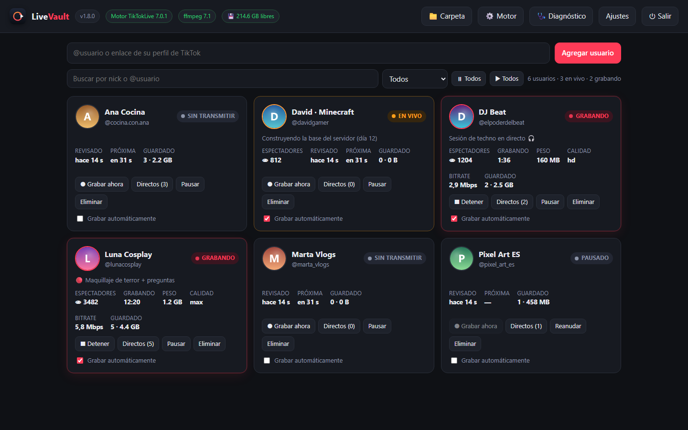
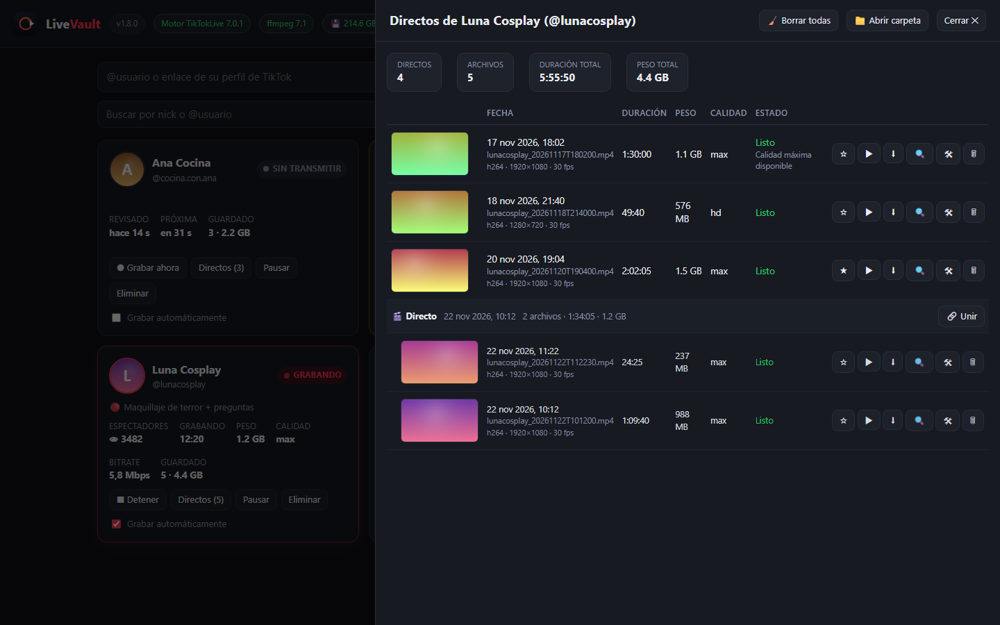
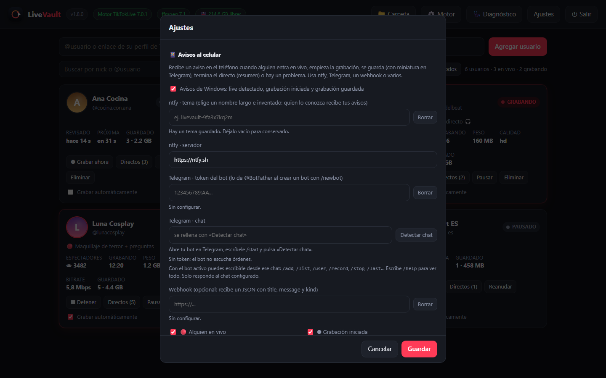

<p align="center">
  
</p>

# LiveVault

**Vigila usuarios de TikTok y graba sus directos automáticamente**, varios a la vez, mientras tú
haces otra cosa. Vive en la bandeja del sistema, te avisa al móvil y guarda un historial por usuario.

Es un programa portable para Windows 10/11 (64 bits): **descargas un `.exe`, doble clic y ya está**.
No hace falta instalar Python ni ffmpeg.

[⬇️ Descargar la última versión](../../releases/latest) · [Manual completo](LEEME.md) · [Cambios](CHANGELOG.md)

---

## Empezar en 3 pasos

1. **Descarga `LiveVault-<versión>.exe`** desde [Releases](../../releases/latest).
2. Guárdalo **en una carpeta local** (por ejemplo `C:\LiveVault`, mejor fuera de OneDrive) y ábrelo.
3. Pega un `@usuario` de TikTok y dale a **Agregar usuario**. Cuando esa persona empiece un directo,
   LiveVault lo detecta, te avisa y lo graba.

Los datos (usuarios, ajustes y grabaciones) se guardan en la carpeta `datos` **junto al `.exe`**, así
que si mueves el programa, mueve la carpeta entera.

### «Windows protegió su PC» / el antivirus se queja

El `.exe` **no está firmado** (un certificado de firma cuesta dinero al año). Windows SmartScreen y
algunos antivirus avisan por defecto con programas nuevos y poco descargados:

- SmartScreen: **Más información → Ejecutar de todas formas**.
- Antivirus: es un falso positivo típico de los `.exe` hechos con PyInstaller; añádelo a exclusiones.
- Si prefieres no fiarte de un binario ajeno (es sano), puedes comprobarlo: el `SHA256SUMS.txt` de
  cada release permite verificar la descarga, y el código está aquí para leerlo y compilarlo tú.

```powershell
Get-FileHash .\LiveVault-*.exe -Algorithm SHA256   # debe coincidir con SHA256SUMS.txt
```

---

## Así se ve



*Cada usuario con su estado, sus espectadores y lo que está grabando. Con «Directos (5)» abres su
historial y con «Pausar» dejas de vigilarlo sin borrarlo.*



*Un directo sigue siendo una sola entrada aunque se corte: los trozos se pueden unir con «Unir» sin
recodificar (no se pierde calidad). Las favoritas ★ no se borran con la limpieza automática.*



*Avisos por ntfy, Telegram o webhook; carpetas y calidad; retención por días o tamaño; y el bot de
Telegram, que además acepta órdenes como `/add` o `/record`.*

---

## Qué hace

- **Varios directos a la vez**, cada usuario en su carpeta.
- **Graba en MP4 fragmentado**: el archivo se puede reproducir *mientras* se graba y queda válido
  aunque el programa se cierre de golpe.
- **Sin recodificar**: copia el stream tal cual, sin gastar CPU ni perder calidad.
- **Bandeja del sistema**: colores del icono (gris vigilando · naranja en vivo · rojo grabando).
  Cerrar la ventana no cierra el programa; sigue grabando.
- **Avisos al móvil** por [ntfy](https://ntfy.sh), **Telegram** (con miniatura y comandos) o webhook.
- **Bot de Telegram**: `/add`, `/list`, `/user`, `/record`, `/stop`, `/last`, `/del`… desde el móvil.
- **Favoritas (★)**, borrar todas, retención por días o tamaño, aviso de poco disco.
- **Un directo = una sesión**: los cortes y reconexiones se agrupan y se pueden unir con un clic.
- **Diagnóstico**: reporte, logs y paquete de soporte SIN claves (y con las rutas de tu PC ocultas).

Detalles de todo esto en el [manual completo](LEEME.md).

---

## Privacidad y seguridad

- El panel es una página **local**: escucha solo en `127.0.0.1` y **solo responde con una clave
  aleatoria** que se genera en tu PC (`datos/panel.token`). Otra web, u otro programa del equipo,
  no puede leer tus grabaciones ni cambiar los ajustes.
- Los secretos (`sessionid`, token del bot, proxy y webhook) se guardan **cifrados con tu usuario de
  Windows (DPAPI)**. Si copias `datos` a otro PC, tendrás que volver a escribirlos.
- Los reportes y logs **ocultan** claves, `sessionid` y credenciales automáticamente.
- **No hay telemetría ni servidor propio**: el programa solo habla con TikTok (para detectar y bajar
  el directo) y con los servicios de aviso que tú configures (ntfy, Telegram, webhook). Nada más.
- El programa guarda en `datos/logs/` un registro de lo que hace (sin secretos), para poder
  diagnosticar fallos.

Más detalles y cómo reportar un problema de seguridad: [SECURITY.md](SECURITY.md).

---

## Uso responsable

LiveVault graba directos **públicos** de TikTok. Úsalo solo para contenido al que tengas derecho de
acceso y respeta los derechos de autor, la privacidad de los creadores y las condiciones de uso de
TikTok. No está pensado para acosar, vigilar a personas sin su consentimiento ni redistribuir
contenido ajeno. El software se ofrece **sin garantía** (licencia MIT) y TikTok puede cambiar o
bloquear su API en cualquier momento.

---

## Problemas frecuentes

| Síntoma | Qué hacer |
|---|---|
| No detecta directos | **Motor → Buscar y actualizar motor**. Si TikTok cambió algo, esto lo arregla. |
| No graba, pero está en vivo | Revisa el chip **ffmpeg** y el aviso amarillo del panel. |
| Lives +18 no se graban | Hacen falta: Ajustes → `sessionid` (cookie de tu cuenta). |
| Algo va mal y no sé qué | **Diagnóstico → Paquete de soporte** y ábre un *issue*. Revisa antes lo que envías. |
| Quiero abrirlo otra vez | Clic en el icono de la bandeja. Si lo cerraste del todo, abre el `.exe`. |
| El puerto 8765 está ocupado | Se busca otro automáticamente; también puedes usar `LiveVault.exe --port 9000`. |

Antes de preguntar, mira `datos/logs/errores.log` o el visor de logs del panel: casi siempre dice
qué falló.

---

## Cómo se usa con Python (desarrollo)

No lo necesita quien descarga el `.exe`. Si vas a tocar el código:

```bash
python -m venv .venv
.venv\Scripts\pip install -r requirements.txt -c constraints.txt
.venv\Scripts\python app.py
```

Pruebas y empaquetado: [CONTRIBUTING.md](CONTRIBUTING.md).

---

## Licencia

[MIT](LICENSE): puedes usarlo, modificarlo y compartirlo citando el aviso de copyright. Las
bibliotecas y binarios de terceros que van dentro del `.exe` tienen sus propias licencias; ver
[THIRD_PARTY_NOTICES.md](THIRD_PARTY_NOTICES.md).

---

<details>
<summary><b>English summary</b></summary>

LiveVault watches TikTok users and automatically records their livestreams (several at once) on
Windows 10/11 x64. **Download the latest `.exe` from [Releases](../../releases/latest), run it — no
Python or ffmpeg install needed.** Keep it in a local folder; data lives in `datos\` next to the
executable. The binary is unsigned, so SmartScreen may warn (More info → Run anyway) and some
antivirus engines may flag PyInstaller binaries; verify the SHA-256 from the release.

The local panel only listens on `127.0.0.1` and requires a random per-install token, secrets are
encrypted with Windows DPAPI, and diagnostic reports redact credentials and local paths. No
telemetry. Record only public livestreams you have the right to access, and respect copyright and
TikTok's terms. MIT licensed, no warranty.

</details>
